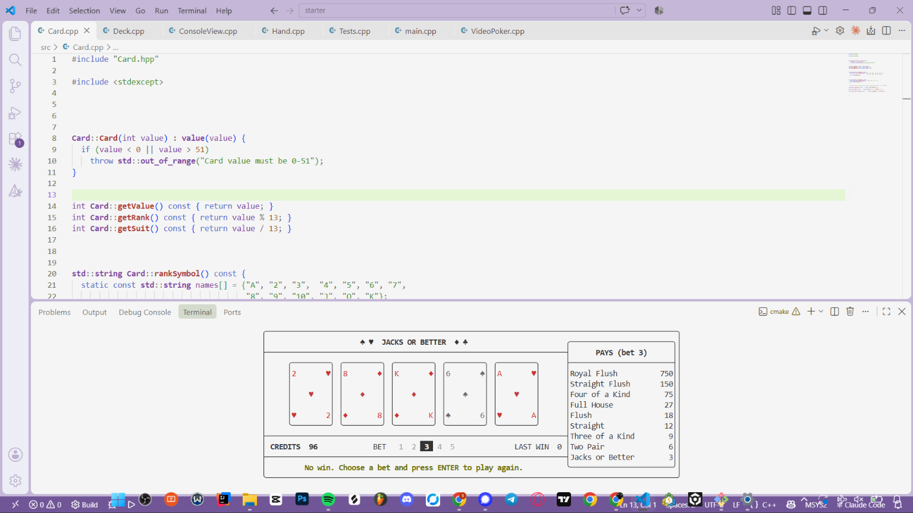

# P01 — Video Poker (Jacks or Better) 

**Game chosen:** Option A, Video Poker (Jacks or Better).

One game class (`VideoPoker`) and two views (`ConsoleView`, `TuiView`).
`main()` holds a `std::unique_ptr<GameView>` and calls `view->run()` without
knowing which view it has.



## How to build and run

Windows, MSYS2 UCRT64 g++, from the VS Code terminal inside `starter/`:

```powershell
cmake -S . -B build -G Ninja
cmake --build build

.\build\game.exe           # FTXUI terminal UI
.\build\game.exe --text    # plain cout/cin version
.\build\game.exe --test    # rule tests, PASS/FAIL
```

macOS / Linux:

```bash
cmake -S . -B build
cmake --build build
./build/game
```

## How to play

**TUI (`game.exe`)**

| Phase   | Keys |
| ------- | ---- |
| Betting | `↑` `↓` or `1`–`5` choose bet, `ENTER` deal |
| Holding | `←` `→` move, `SPACE` hold/unhold, `ENTER` draw |
| Game over | `N` new game |
| Any time | `Q` quit |

The keys for the current phase are always shown at the bottom of the screen.
The pay table on the right shows what each hand pays at the current bet and
highlights the hand you just won.

**Text (`game.exe --text`)**: type a bet (1–5), then type card numbers like
`1 3` to toggle holds, and press Enter on an empty line to draw. `q` quits.

## Files

| File | What it is |
| ---- | ---------- |
| `Card`, `Deck`, `GameView` | From the starter (unchanged) |
| `Hand` | The 5 cards. Holds a private `vector<Card>` (composition, not inheritance). `at()` and `replace()` throw `std::out_of_range`. |
| `VideoPoker` | All the rules and state. A state machine (`Phase::Betting`, `Holding`, `GameOver`); every action checks the phase and returns `false` if it isn't allowed. **No `<iostream>`, no FTXUI.** `evaluate()`, `multiplier()`, and `rankName()` are static pure functions. |
| `ConsoleView` | `cout`/`getline` view, ASCII only (`10H`, `KS`). Rejects bad input (`abc`, `5x`, `-3`, `9`) and re-prompts. |
| `TuiView` | FTXUI view based on `Resources/ftxui/main.cpp`. The renderer only reads from the game; each key handler makes one call into the game. It only remembers screen things: cursor position, highlighted bet, message. |
| `Tests` | `runTests()`: 47 checks with stacked decks. Returns 0 if all pass, 1 otherwise. |
| `main.cpp` | Picks the view at run time through `unique_ptr<GameView>`. |

## Tests

`--test` covers every required case:

- every hand rank from Nothing to Royal Flush
- pair of 10s → Nothing, pair of Jacks → Jacks or Better
- A-2-3-4-5 → Straight, 10-J-Q-K-A mixed suits → Straight, Q-K-A-2-3 → not a straight
- royal flush pays 4000 at bet 5 and 250 per credit at bets 1–4
- held cards survive `draw()`, unheld cards are replaced in order

plus phase rules (draw twice, deal while holding, bets of 0/6/-1, betting more
than your credits, game over at 0 credits) and the `Hand` class.

## Design notes

- `VideoPoker::setNextDeck(const Deck&)` lets tests choose the exact cards for
  the next hand. Real games never call it, so every real hand gets a fresh
  shuffled deck.
- I added `newGame()` (GameOver → Betting) so the player can start over
  without restarting the program, plus a few small getters the views need:
  `bet()`, `maxBet()`, and `hasPlayedHand()`.
- Payout: `draw()` pays `bet × multiplier(rank, bet)`. "Pays 1" returns the
  bet, so Jacks or Better breaks even.

## What don't work

Nothing known. Everything in the assignment is implemented and all tests pass after I tried it in my persnonal laptop.

## Changes to Card or Deck

None. Both are used exactly as provided.
